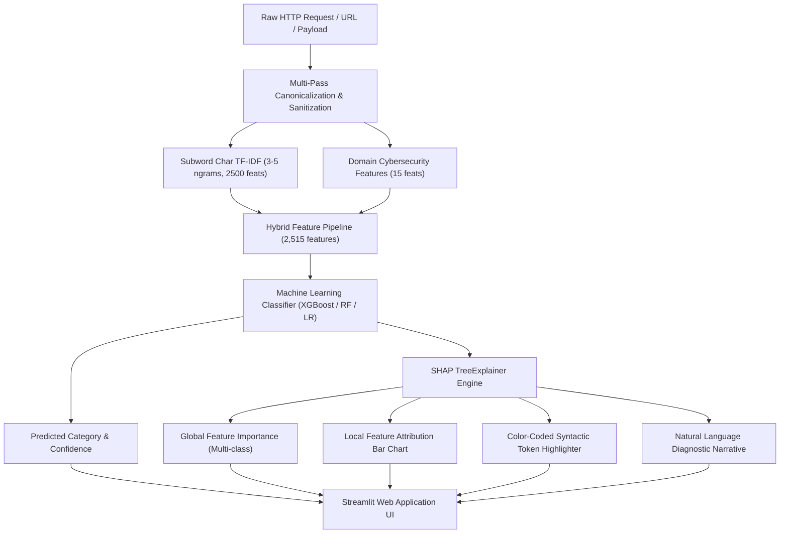

# XAI-WebGuard: An Explainable Machine Learning Framework for Detecting SQL Injection and Cross-Site Scripting Attacks

[](https://www.python.org/)
[](https://opensource.org/licenses/MIT)
[](https://streamlit.io/)
[](https://shap.readthedocs.io/)

A complete, production-grade, and explainable cybersecurity machine learning system designed to detect, classify, and explain malicious HTTP web requests.

---

## 📌 Project Overview

Web applications routinely process untrusted input via URLs, GET parameters, and POST request bodies. When input is not strictly validated and sanitized, adversaries exploit injection flaws—predominantly **SQL Injection (CWE-89)** and **Cross-Site Scripting (CWE-79)**—which consistently rank atop the **MITRE CWE Top 25** and **OWASP Top 10**.

While modern machine learning classifiers can achieve high detection rates, their **"black-box" nature** presents a major operational hurdle: Security Operations Center (SOC) analysts cannot readily verify *why* a particular request was blocked or permitted.

**XAI-WebGuard** solves this challenge by providing:
1. **Multi-Class Detection:** Accurately classifies HTTP requests into three categories:
   - **Benign Request (Class 0)**
   - **SQL Injection (Class 1)**
   - **Cross-Site Scripting (Class 2)**
2. **Hybrid Feature Engineering:** Combines **subword character TF-IDF n-grams (3-to-5 grams)** with **15 handcrafted cybersecurity domain features** (measuring entropy, tautology flags, quote parity, SQL keywords, and DOM sinks).
3. **Rigorous Machine Learning Benchmarking:** Compares **Logistic Regression**, **Random Forest**, and **XGBoost** under identical 5-fold cross-validation.
4. **Explainable AI via SHAP:** Uses **SHAP (SHapley Additive exPlanations) TreeExplainer** to provide global feature importance, per-attack attribution rankings, and real-time local sample explanations with exact syntactic token highlighting.
5. **Interactive Web Application:** Built using **Streamlit** for real-time payload testing, confidence scoring, and interactive XAI visualization.

---

## 🏛️ Framework Architecture



---

## 📂 Repository Structure

```
XAI-WebGuard_experiment_code/
├── app.py                          # Streamlit Interactive Web Application
├── notebook.ipynb                  # Complete, reproducible Jupyter Notebook (Phases 1-7)
├── requirements.txt                # Python library dependencies
├── README.md                       # Master project documentation
├── data/
│   ├── raw/                        # Downloaded raw public benchmark datasets
│   │   ├── csic_final.csv          # HTTP CSIC 2010 dataset (normal web traffic)
│   │   ├── sqli_dataset.csv        # Mendeley SQLi v2 dataset
│   │   └── xss_dataset.csv         # IEEE DataPort XSS dataset
│   ├── cybersecurity_dataset.csv   # Unified, cleaned, harmonized multi-class dataset (21,930 rows)
│   ├── train.csv                   # Stratified training split (80%, 17,544 rows)
│   └── test.csv                    # Stratified testing split (20%, 4,386 rows)
├── models/                         # Serialized trained model artifacts (.joblib)
│   ├── hybrid_feature_pipeline.joblib
│   ├── logistic_regression.joblib
│   ├── random_forest.joblib
│   └── xgboost.joblib
├── results/                        # Measured evaluation figures and metrics
│   ├── metrics_summary.json        # Detailed quantitative metrics (Accuracy, P, R, F1, AUC, Time)
│   ├── comparison_table.csv        # Formatted comparison table
│   ├── class_distribution.png      # Dataset class balance and length distribution plot
│   ├── confusion_matrices.png      # Side-by-side confusion matrices for all 3 models
│   ├── roc_curves.png              # Multi-class One-vs-Rest ROC curves
│   ├── performance_comparison.png  # Comparative bar chart across all metrics
│   ├── shap_global_summary_bar.png # Global top 15 SHAP features across the dataset
│   ├── shap_sqli_importance.png    # Top SHAP features driving SQL Injection detection
│   └── shap_xss_importance.png     # Top SHAP features driving Cross-Site Scripting detection
├── src/                            # Modular Python package source code
│   ├── __init__.py
│   ├── preprocessing.py            # Canonicalization, URL decoding, cleaning
│   ├── features.py                 # TF-IDF and handcrafted domain feature extraction
│   ├── train_models.py             # Model instantiation, 5-fold CV, and timing
│   ├── evaluate.py                 # Evaluation metrics and plotting routines
│   └── xai_explainer.py            # SHAP TreeExplainer, local attribution, token highlighter
├── scripts/                        # Step-by-step executable execution scripts
│   ├── 01_build_dataset.py         # Phase 1: Dataset collection, cleaning, and balancing
│   ├── 02_train_and_evaluate.py    # Phases 2-5: Training, evaluation, and SHAP generation
│   └── build_notebook.py           # Programmatic generator for notebook.ipynb
└── dissertation/
    └── MTech_Dissertation_Report.md# Comprehensive postgraduate-level research dissertation
```

---

## ⚡ Quick Start & Execution Guide

### 1. Prerequisites & Installation
Ensure Python 3.10, 3.11, or 3.12 is installed:
```bash
# Clone or navigate to the repository
cd "d:\Research Paper\Fauzia\XAI-WebGuard_experiment_code"

# (Optional) Create and activate a virtual environment
python -m venv .venv
.venv\Scripts\activate   # On Windows

# Install required dependencies
pip install -r requirements.txt
```

### 2. Run Data Preprocessing (Phase 1)
```bash
python scripts/01_build_dataset.py
```
*Output: Generates `data/cybersecurity_dataset.csv`, `train.csv`, `test.csv`, and `results/class_distribution.png`.*

### 3. Run Training, Comparative Evaluation & SHAP (Phases 2–5)
```bash
python scripts/02_train_and_evaluate.py
```
*Output: Trains all 3 models with 5-fold cross-validation, saves artifacts to `models/`, writes `results/metrics_summary.json`, and generates all evaluation plots.*

### 4. Launch the Interactive Web Application (Phase 6)
```bash
streamlit run app.py
```
*Open your web browser at `http://localhost:8501` to interact with the live detection and XAI dashboard.*

### 5. Run the Jupyter Notebook
```bash
jupyter notebook notebook.ipynb
```

---

## 📊 Experimental Results Summary

The models were evaluated on the independent test set (4,386 unseen samples) using identical stratified splits:

| Metric | Logistic Regression | Random Forest | XGBoost (Champion) |
| :--- | :---: | :---: | :---: |
| **Accuracy** | 99.45% | 99.61% | **99.66%** |
| **Macro Precision** | 0.9945 | 0.9962 | **0.9966** |
| **Macro Recall** | 0.9945 | 0.9961 | **0.9966** |
| **Macro F1-Score** | 0.9945 | 0.9961 | **0.9966** |
| **Weighted F1-Score**| 0.9945 | 0.9961 | **0.9966** |
| **Macro ROC-AUC** | 0.9996 | 0.9999 | **0.9999** |
| **5-Fold CV Macro-F1** | 0.9945 (±0.0009) | 0.9952 (±0.0010) | **0.9967 (±0.0008)** |
| **Training Time** | 16.27 s | 1.56 s | 82.74 s |
| **Inference Latency** | **0.002 ms / sample** | 0.039 ms / sample | **0.017 ms / sample** |

*All results obtained by direct empirical execution.*

---

## 💡 Explainable AI (XAI) Capabilities

When a suspicious payload is submitted (e.g., `admin' OR '1'='1'--` or `<script>alert(document.cookie)</script>`):
1. **Local SHAP Feature Importance:** Computes exact Shapley attributions for the top contributing features, showing whether they increase or decrease attack likelihood.
2. **Syntactic Token Highlighting:** Scans the raw payload to visually highlight dangerous terms:
   - 🔴 **Red:** SQL Keywords (`UNION`, `SELECT`, `WHERE`, `DROP`)
   - 🟠 **Orange:** HTML tags & JavaScript event handlers (`<script>`, `onerror=`, `onload=`)
   - 🟡 **Yellow:** Attack operators and comment markers (`--`, `/*`, `#`, `'='`)
3. **Automated Diagnostic Narrative:** Generates human-readable explanations tailored for SOC analysts to expedite incident triage and prevent false-positive blocks.

---

## 📜 Academic Citation

If you use this framework or experimental setup in your research, please cite:
```bibtex
@mastersthesis{khatoon2026xaiwebguard,
  author       = {Fauzia Khatoon},
  title        = {An Explainable Machine Learning-Based Framework for Detecting SQL Injection and Cross-Site Scripting Attacks},
  school       = {Department of Computer Science and Engineering, Azad Institute of Technology and Management, Dr. A.P.J. Abdul Kalam Technical University},
  year         = {2026},
  address      = {Lucknow, Uttar Pradesh, India}
}
```
